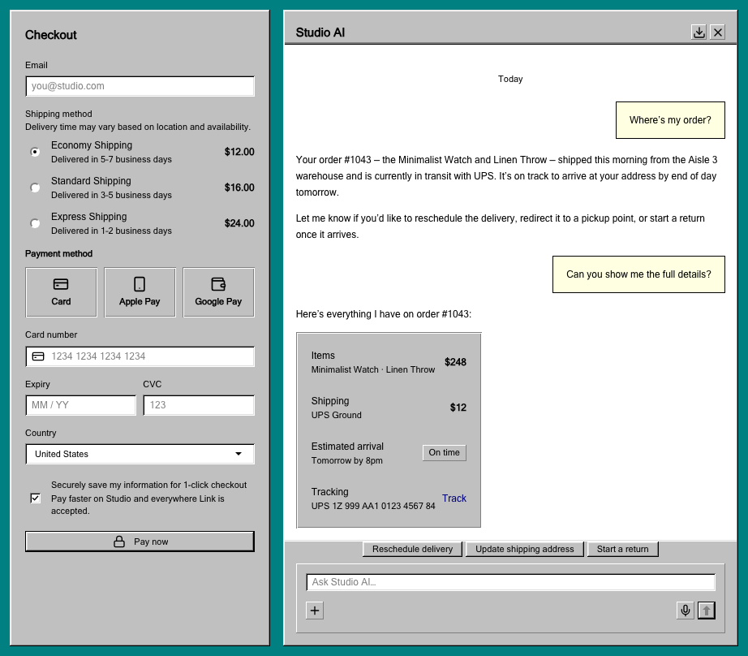
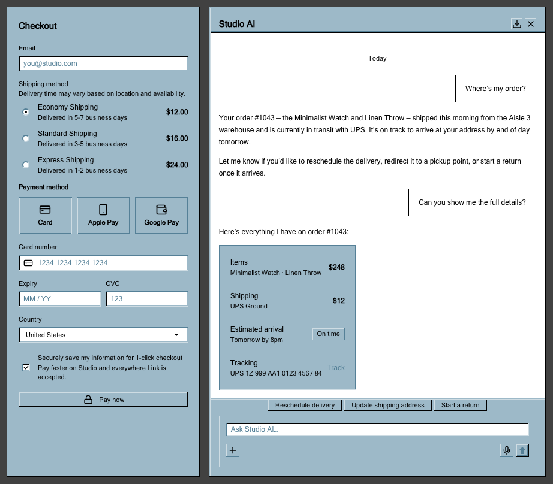

# astryx-theme-windows98

A Windows 98 theme for [Astryx](https://github.com/meta/astryx): square corners, dense controls, 3D bevels, recessed input fields, dotted keyboard-focus rectangles, and effectively no animation. Light mode is the Windows 98 "Windows Standard" appearance; dark mode is the Windows 9x "Slate" scheme.

The theme prioritises period fidelity over modern design-system conventions.

| Windows Standard (light)                                                                                                                                   | Slate (dark)                                                                                                                                 |
| ---------------------------------------------------------------------------------------------------------------------------------------------------------- | -------------------------------------------------------------------------------------------------------------------------------------------- |
|  |  |

## Install

```bash
npm install astryx-theme-windows98
```

Requires `@astryxdesign/core` 0.7.13 or later in the 0.7 line, and React 19.

## Usage

Wrap your app with `Theme` and pass the theme:

```tsx
import {Theme} from '@astryxdesign/core/theme';
import {windows98Theme} from 'astryx-theme-windows98/built';

function App() {
  return <Theme theme={windows98Theme}>{/* your app */}</Theme>;
}
```

### Import paths

| Path                               | Use case                                                    |
| ---------------------------------- | ----------------------------------------------------------- |
| `astryx-theme-windows98`           | Source build (StyleX compilation via `@astryxdesign/build`) |
| `astryx-theme-windows98/built`     | Pre-built dist (Tailwind, plain CSS, or no build step)      |
| `astryx-theme-windows98/theme.css` | Pre-built CSS file (import in your stylesheet)              |

If you're using `@astryxdesign/build` for StyleX source compilation, import from the bare path. Otherwise, use `/built`.

### CSS import

Add the theme CSS to your stylesheet:

```css
@import 'astryx-theme-windows98/theme.css';
```

## Color modes

Astryx's light and dark modes map onto the two classic appearance schemes:

| Astryx mode | Windows scheme   | Desktop   | Face      | Text      |
| ----------- | ---------------- | --------- | --------- | --------- |
| Light       | Windows Standard | `#008080` | `#C0C0C0` | `#000000` |
| Dark        | Slate            | `#414141` | `#9DB9C8` | `#000000` |

**Slate is not a modern dark mode.** It has a dark desktop, but its controls are a light blue-grey with black text, exactly as the original scheme shipped. Treat it as a second light scheme with a dark backdrop rather than an inverted palette.

## Edges

Win9x chrome is drawn with `DrawEdge` and `DrawFrameControl`, which are not the same bevel. The theme keeps all four distinct, since using one for everything is visibly wrong:

| Edge           | Used by                 | Outer top-left | Inner top-left |
| -------------- | ----------------------- | -------------- | -------------- |
| `raised`       | dialogs, popovers, tabs | 3DLIGHT        | 3DHILIGHT      |
| `raisedButton` | push buttons            | 3DHILIGHT      | 3DLIGHT        |
| `sunken`       | fields, lists, tables   | 3DSHADOW       | 3DDKSHADOW     |
| `etched`       | nested panels           | 3DSHADOW       | 3DHILIGHT      |

Window chrome and push buttons differ only in the top-left pair. Bottom-right is 3DDKSHADOW outside, 3DSHADOW inside for both.

Nested cards pick up the etched edge automatically: a card containing another card pins itself raised and publishes the etched edge to its descendants through an inherited custom property.

## Disabled controls

Win9x does not fade disabled controls. It engraves their labels: the text is drawn in the shadow colour over a highlight copy offset 1px down and right. The theme does the same for buttons (including their icons), menu items, radio rows, links, and checkbox, switch and field captions, in both schemes. Disabled edit fields and drop-downs keep their sunken edge, drop to the face colour, and show flat GrayText, as the originals did.

## Placeholders

Windows 98 edit controls had no placeholder text. The theme follows the closest period equivalent, Windows XP's cue banners, and draws placeholders in GrayText so they never read as typed values.

## Icons

The theme ships its own icon registry covering every icon name Astryx components use. The artwork is original, drawn on a 16-unit grid in period shapes: solid triangles for drop-downs and scroll buttons, the heavy caption-button cross, and message-box style status icons. It paints in `currentColor`, so the theme's icon colours apply.

## Fonts

This theme uses the classic system typefaces:

| Role            | Font          | Fallbacks                                       |
| --------------- | ------------- | ----------------------------------------------- |
| Body / Headings | MS Sans Serif | Microsoft Sans Serif, Tahoma, Arial, sans-serif |
| Code            | Courier New   | Courier, monospace                              |

**These are deliberately not bundled and not loaded from a font CDN.** MS Sans Serif is a proprietary Microsoft face, and the point of the theme is to use whatever the host system has. `astryx theme build` warns that the named fonts are not loaded; for this theme that warning is expected and can be ignored.

On systems without MS Sans Serif the fallback stack resolves to Tahoma or Arial, which is close enough that the layout metrics still hold.

## Development

```bash
pnpm install
pnpm build      # theme CSS and built theme, then the JS and type entries
pnpm typecheck
```

## License

[MIT](LICENSE) © 2026 Alex Rock.

Windows is a trademark of Microsoft Corporation. This project is not affiliated with or endorsed by Microsoft, and it ships no Microsoft artwork or fonts. It is also an independent theme, not part of the Astryx project.
